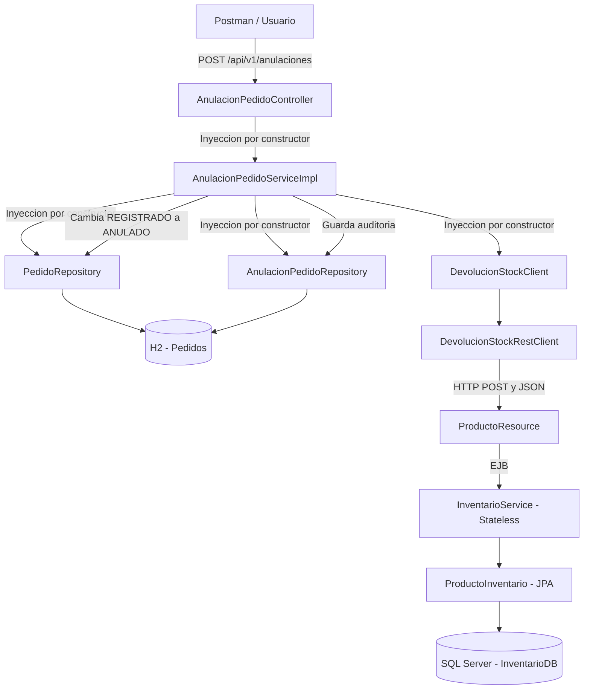

# Arquitectura PA2

## Responsabilidades

- `AnulacionPedidoController` recibe las solicitudes HTTP.
- `AnulacionPedidoServiceImpl` valida y coordina la anulación.
- `DevolucionStockClient` desacopla Spring Boot del contrato remoto.
- `ProductoResource` expone la devolución mediante Jakarta REST.
- `InventarioService` ejecuta la transacción local de Inventario.
- `PedidoRepository` y `AnulacionPedidoRepository` guardan los cambios en H2.
- `ProductoInventario` actualiza el stock en SQL Server.
