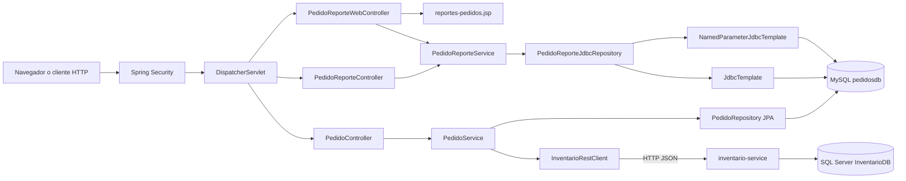

# Arquitectura PA3

El módulo conserva Spring Data JPA para registrar pedidos y utiliza Spring JDBC exclusivamente para las consultas nuevas de supervisión.

## Responsabilidades

- `Spring Security` autentica y autoriza antes de que la solicitud alcance los controladores.
- `PedidoReporteWebController` carga el `Model` y selecciona la vista JSP.
- `PedidoReporteController` publica las representaciones JSON y traduce validaciones a HTTP 400.
- `PedidoReporteService` concentra las reglas de validación y evita SQL en la capa web.
- `PedidoReporteJdbcRepository` ejecuta SQL parametrizado y mapea resultados simples o agregados.
- `PedidoRepository` conserva el flujo transaccional existente mediante Spring Data JPA.
- `InventarioRestClient` mantiene la integración externa usada al registrar pedidos.

## Frontera transaccional

La transacción local de Spring cubre los cambios de pedidos en MySQL. La reserva efectuada por HTTP en `inventario-service` pertenece a otro proceso y a otra base; no existe una transacción distribuida entre MySQL y SQL Server.
